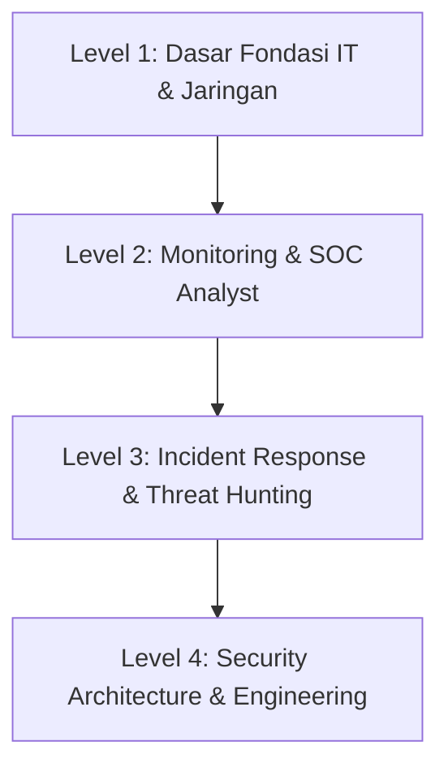

# 🛡️ Peta Jalan Belajar (Roadmap): Blue Team & Pertahanan Siber

Jalur **Blue Team** berfokus pada pertahanan sistem, pemantauan ancaman (*monitoring*), deteksi intrusi, penanganan insiden (*incident response*), dan analisis forensik digital.

---

## 🗺️ Tahapan Belajar (Level 1 - Level 4)

### 🔹 Level 1: Fondasi Sistem & Jaringan
- [ ] Memahami Model OSI & TCP/IP, cara kerja DNS, DHCP, HTTP/S, SSL/TLS.
- [ ] Penggunaan dasar Wireshark untuk menganalisis paket data (PCAP).
- [ ] Administrasi dasar Linux & Windows Event Logs (Event ID krusial: 4624, 4625, 4688, 7045).
- [ ] Konsep dasar keamanan: CIA Triad, Defense in Depth, Principle of Least Privilege.

### 🔹 Level 2: SOC Analyst (Security Operations Center)
- [ ] **SIEM & Log Management**: Memahami arsitektur SIEM, query log (Wazuh, Elastic Security, Splunk).
- [ ] **EDR (Endpoint Detection and Response)**: Pemantauan aktivitas proses endpoint (Sysmon, Velociraptor).
- [ ] **Analisis Email Phishing**: Memeriksa header email (SPF, DKIM, DMARC), ekstraksi URL/attachment berbahaya.
- [ ] **Framework Pengenalan Serangan**: Memetakan taktik dan teknik dengan [MITRE ATT&CK](https://attack.mitre.org/).

### 🔹 Level 3: Incident Response (IR) & Threat Hunting
- [ ] Metodologi Penanganan Insiden berdasarkan PICERL (Preparation, Identification, Containment, Eradication, Recovery, Lessons Learned) / NIST SP 800-61.
- [ ] **Digital Forensics**:
  - Memory Forensics: Dump RAM dan analisis artefak menggunakan Volatility.
  - Disk Forensics: Analisis file system NTFS/EXT4, MFT, Prefetch, Registry, LNK files dengan Autopsy atau FTK Imager.
- [ ] Pembuatan aturan deteksi: YARA Rules dan Sigma Rules.

### 🔹 Level 4: Arsitektur & Hardening
- [ ] Hardening Server & Jaringan berdasarkan CIS Benchmarks.
- [ ] Implementasi Zero Trust Architecture (ZTA).
- [ ] Otomasi Keamanan (SOAR - Security Orchestration, Automation, and Response) dengan Shuffle atau Tines.

---

## 🛠️ Tools Wajib Blue Team
| Kategori | Tool Open Source Rekomendasi |
| :--- | :--- |
| **SIEM & XDR** | [Wazuh](https://wazuh.com/), [Elastic Security](https://www.elastic.co/security) |
| **Network Security Monitoring (NSM)** | [Suricata](https://suricata.io/), [Zeek](https://zeek.org/) |
| **Endpoint / DFIR** | [Velociraptor](https://github.com/Velocidex/velociraptor), [Sysinternals Suite](https://learn.microsoft.com/en-us/sysinternals/) |
| **Threat Intelligence** | [MISP](https://www.misp-project.org/), [OpenCTI](https://www.opencti.io/) |
