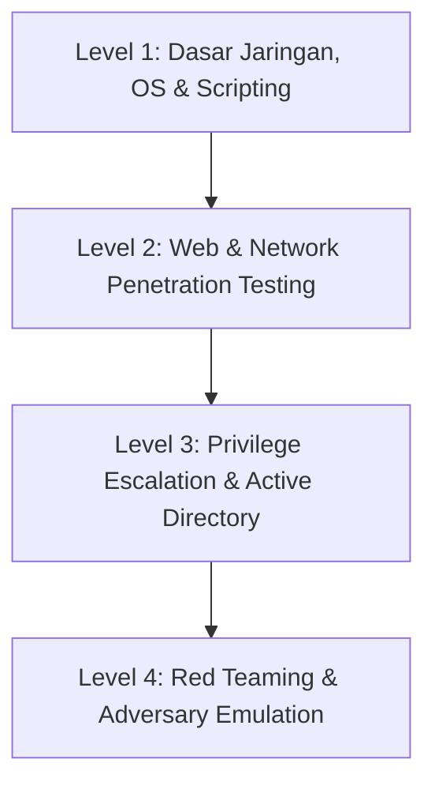

# ⚔️ Peta Jalan Belajar (Roadmap): Red Team & Penetration Testing

Jalur **Red Team** berfokus pada pengujian keamanan ofensif secara etis, simulasi serangan musuh nyata (*adversary simulation*), dan penemuan celah keamanan (*penetration testing / bug bounty*).

---

## 🗺️ Tahapan Belajar (Level 1 - Level 4)

### 🔹 Level 1: Fondasi Teknis
- [ ] Dasar jaringan: Port, protokol, routing, firewall, NAT.
- [ ] Penguasaan perintah terminal Linux & Bash scripting.
- [ ] Pemrograman dasar untuk otomatisasi pengujian: Python, Go, atau PowerShell.
- [ ] Cara kerja web: Arsitektur client-server, REST API, Cookies, Session, CORS, Same-Origin Policy.

### 🔹 Level 2: Web & Network Pentesting
- [ ] **Reconnaissance & OSINT**: Pengumpulan informasi target pasif dan aktif (Amass, Sublist3r, theHarvester).
- [ ] **Network Scanning & Enumeration**: Nmap, Masscan, identifikasi layanan terbuka dan versinya.
- [ ] **OWASP Top 10 (Web Security)**:
  - Injection (SQLi, Command Injection)
  - Broken Access Control (IDOR, Privilege Escalation)
  - Cross-Site Scripting (XSS: Stored, Reflected, DOM)
  - Server-Side Request Forgery (SSRF)
  - Insecure Deserialization
- [ ] Penggunaan interception proxy: Burp Suite Community Edition / OWASP ZAP.

### 🔹 Level 3: Privilege Escalation & Active Directory (AD) Pentesting
- [ ] **Linux Privilege Escalation**: SUID binaries, sudo rights, cron jobs, kernel exploits, capability abuse (LinPEAS).
- [ ] **Windows Privilege Escalation**: Unquoted service paths, token impersonation, DLL hijacking (WinPEAS).
- [ ] **Active Directory Pentesting**:
  - Kerberos Attacks: Kerberoasting, AS-REP Roasting, Pass-the-Hash.
  - Enumerasi Domain dengan BloodHound.
  - Lateral Movement & Domain Escalation.

### 🔹 Level 4: Advanced Red Teaming & Evasion
- [ ] Command & Control (C2) Frameworks (Havoc, Sliver, Mythic).
- [ ] Evasion: Antivirus & EDR evasion (AMSI bypass, process injection, obfuscation).
- [ ] Social Engineering & Physical Pentesting secara legal sesuai *Scope of Work*.
- [ ] Penulisan laporan eksekutif dan teknis (*Executive & Technical Pentest Report*).

---

## 🛠️ Tools Wajib Red Team
| Kategori | Tool Open Source Rekomendasi |
| :--- | :--- |
| **Recon & OSINT** | [Subfinder](https://github.com/projectdiscovery/subfinder), [Amass](https://github.com/owasp-amass/amass) |
| **Web Testing** | [OWASP ZAP](https://www.zaproxy.org/), [Nuclei](https://github.com/projectdiscovery/nuclei), [Sqlmap](https://sqlmap.org/) |
| **Network & Enum** | [Nmap](https://nmap.org/), [Netcat](https://nc110.sourceforge.io/) |
| **Post-Exploitation / C2** | [Sliver](https://github.com/BishopFox/sliver), [Havoc](https://github.com/HavocFramework/Havoc) |
| **AD Enumeration** | [BloodHound](https://github.com/SpecterOps/BloodHound) |
