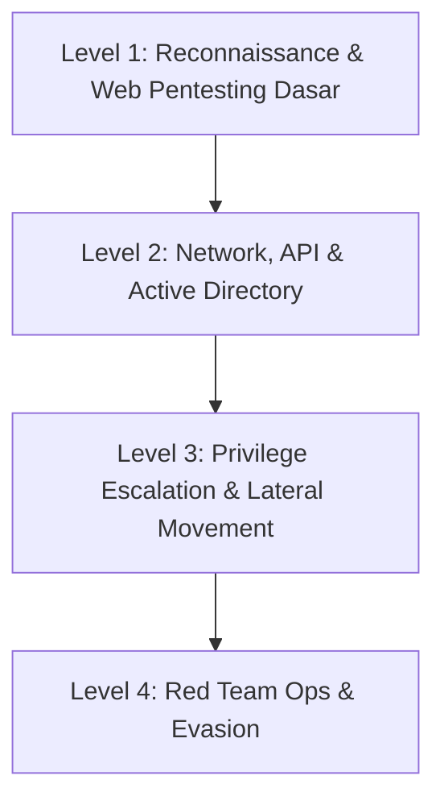

# ⚔️ Domain: Offensive Security (Red Team, Pentesting, Bug Bounty)

Jalur **Offensive Security** berfokus pada simulasi serangan musuh nyata (*adversary simulation*), pengujian penetrasi (*penetration testing*), dan penemuan celah keamanan sebelum dieksploitasi oleh pihak yang tidak bertanggung jawab.

---

## 🗺️ Tahapan Belajar (Level 1 - Level 4)

### 🔹 Level 1: Reconnaissance & Pengujian Web Dasar
- [ ] Pengumpulan informasi pasif & aktif (OSINT, DNS enumeration, subdomain discovery).
- [ ] Pemahaman OWASP Top 10 (Injection, Broken Object Level Authorization, XSS, SSRF).
- [ ] Penguasaan Interception Proxy (Burp Suite Community / OWASP ZAP).
- [ ] Dasar pelaporan temuan kerentanan (*Vulnerability Writeup*).

### 🔹 Level 2: Network, API, dan Active Directory
- [ ] Pemindaian port & enumerasi layanan jaringan dengan Nmap.
- [ ] Pengujian keamanan REST API & GraphQL (OWASP API Top 10).
- [ ] Konsep Active Directory: Mengidentifikasi Domain Controller, Kerberos Ticket, dan pemetaan hak akses dengan BloodHound.

### 🔹 Level 3: Privilege Escalation & Lateral Movement
- [ ] Eskalasi hak akses di Linux (SUID binary, sudo rights, cronjob injection, capabilities).
- [ ] Eskalasi hak akses di Windows (Unquoted service path, DLL hijacking, Token Impersonation).
- [ ] Gerakan lateral di jaringan Windows (Pass-the-Hash, PsExec, WMI, Kerberoasting).

### 🔹 Level 4: Red Teaming & Evasion
- [ ] Command & Control (C2) Framework (Sliver, Havoc, Mythic).
- [ ] Evasion: Memahami cara kerja Antivirus dan EDR, AMSI Bypass, dan proses injeksi memori.
- [ ] Social Engineering terencana & simulasi penyerang tingkat lanjut (Emulasi APT).
