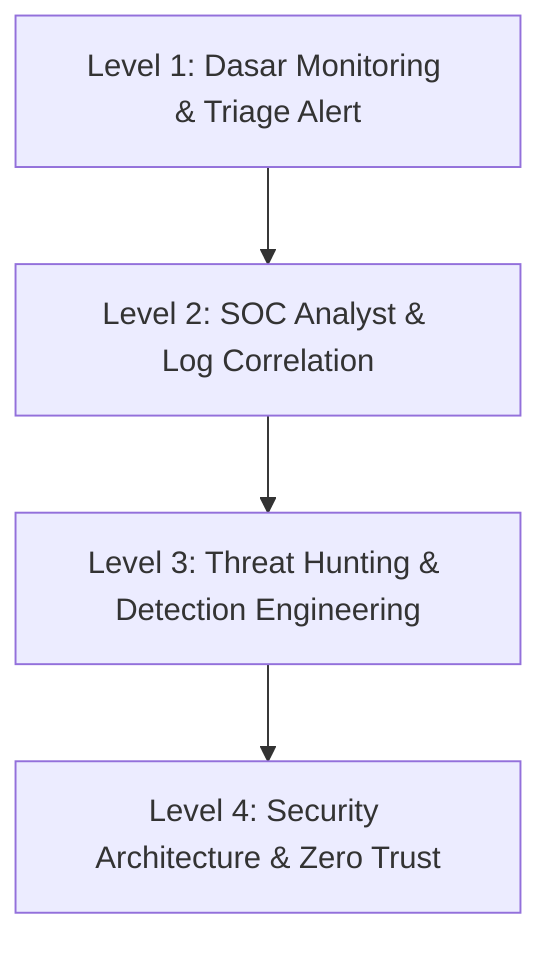

# 🛡️ Domain: Defensive Security (Blue Team, SOC, Cyber Defense)

Jalur **Defensive Security** berfokus pada pemantauan terus-menerus (*24/7 security monitoring*), deteksi anomali, perburuan ancaman (*threat hunting*), dan pertahanan proaktif terhadap infrastruktur informasi organisasi.

---

## 🗺️ Tahapan Belajar (Level 1 - Level 4)

### 🔹 Level 1: Pemantauan Dasar & Analisis Triage (Tier 1 SOC Analyst)
- [ ] Memahami cara kerja SIEM dan membedakan antara *True Positive*, *False Positive*, dan *Benign Activity*.
- [ ] Analisis serangan email (Phishing): Ekstraksi header email, validasi SPF, DKIM, dan DMARC.
- [ ] Pemeriksaan hash file dan reputasi IP/Domain menggunakan OSINT (VirusTotal, AlienVault OTX, AbuseIPDB).

### 🔹 Level 2: Korelasi Log & Analisis Insiden (Tier 2 SOC Analyst)
- [ ] Penyelidikan mendalam pada Windows Event Logs (Sysmon) dan Linux Auth Logs.
- [ ] Menganalisis log lalu lintas jaringan dari firewall, IDS/IPS, dan proxy web.
- [ ] Memetakan setiap alert ke taktik dan teknik [MITRE ATT&CK](https://attack.mitre.org/).

### 🔹 Level 3: Detection Engineering & Threat Hunting (Tier 3 SOC / Hunter)
- [ ] Merancang dan menulis aturan deteksi generik berbasis [Sigma Rules](https://github.com/SigmaHQ/sigma).
- [ ] Menulis aturan deteksi malware menggunakan YARA Rules.
- [ ] Hipotesis Threat Hunting: Mencari jejak penyerang di lingkungan jaringan tanpa menunggu adanya alert dari SIEM.

### 🔹 Level 4: Arsitektur Pertahanan & Otomasi
- [ ] Implementasi Zero Trust Network Architecture (ZTNA).
- [ ] Otomasi penanganan insiden menggunakan SOAR (Security Orchestration, Automation, and Response) seperti Shuffle atau Tines.
- [ ] Penerapan CIS Benchmarks untuk pengerasan (*hardening*) sistem operasi dan cloud.
