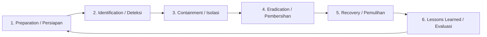

# 📋 Metodologi Penanganan Insiden Siber (Incident Response)

Ketika terjadi insiden peretasan (seperti serangan Ransomware, Web Defacement, atau Kebocoran Data), kepanikan harus dihindari. Tim penangan insiden (CSIRT) harus mengikuti prosedur terstruktur.

---

## 🔄 Siklus Hidup Penanganan Insiden: NIST SP 800-61 vs SANS PICERL

### 1. Preparation (Persiapan)
- Menyusun SOP penanganan insiden dan daftar kontak darurat (*call tree*).
- Menyiapkan *jump bag* (laptop forensik terisolasi, media penyimpanan bersih, software analisis).
- Memastikan log sistem terpusat dan cadangan data (*backup offline*) berjalan rutin.

### 2. Identification (Identifikasi)
- Menentukan apakah suatu alert benar-benar insiden (*True Positive*).
- Menilai cakupan kompromi: Sistem apa saja yang terdampak? Data apa yang bocor?

### 3. Containment (Isolasi & Pembatasan Kerusakan)
- **Short-Term Containment**: Mengisolasi host yang terinfeksi dari jaringan (cabut kabel LAN, matikan Wi-Fi, isolasi via EDR). **Jangan langsung mematikan daya listrik (*hard reboot*)** jika memerlukan bukti artefak di memori RAM!
- **Long-Term Containment**: Blokir IP penyerang di firewall, cabut token sesi pengguna yang terkompromi.

### 4. Eradication (Pembersihan)
- Menemukan dan menghapus seluruh artefak penyerang (malware, webshell, akun siluman yang dibuat penyerang, cronjob persistence).
- Menambal celah masuk utama (*root cause vulnerability*).

### 5. Recovery (Pemulihan)
- Mengembalikan sistem ke kondisi operasional normal dari cadangan (*clean backup*).
- Mengubah seluruh kata sandi dan kredensial yang berpotensi bocor.
- Melakukan pemantauan ketat selama beberapa minggu pasca-pemulihan.

### 6. Lessons Learned (Pembelajaran & Evaluasi)
- Menyusun laporan komprehensif insiden (*Post-Incident Report*).
- Memperbaiki kelemahan yang ditemukan agar insiden serupa tidak terulang di masa depan.
