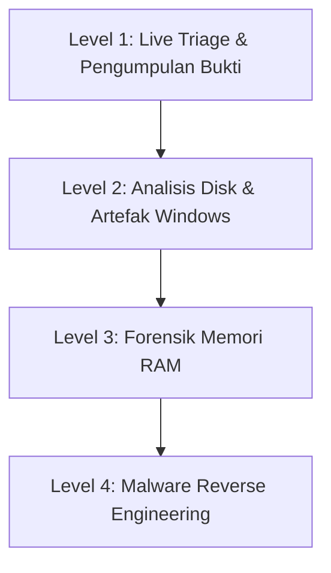

# 🔬 Domain: Forensik Digital & Penanganan Insiden (DFIR)

Jalur **DFIR (Digital Forensics and Incident Response)** berfokus pada penyelidikan ilmiah terhadap jejak digital, pemulihan data setelah insiden peretasan, dan analisis mendalam terhadap perilaku perangkat lunak perusak (*malware*).

---

## 🗺️ Tahapan Belajar (Level 1 - Level 4)

### 🔹 Level 1: Live Triage & Keutuhan Bukti (Chain of Custody)
- [ ] Memahami prinsip *Order of Volatility* (dari yang paling mudah hilang: Register/Cache, RAM, Network State, Disk, Backup).
- [ ] Teknik pembuatan *forensic image* (bit-by-bit copy) dengan `dd`, FTK Imager, atau Guymager.
- [ ] Verifikasi integritas barang bukti elektronik menggunakan cryptographic hash (MD5, SHA-256).

### 🔹 Level 2: Forensik Disk & Artefak Sistem Operasi
- [ ] Menganalisis file system NTFS: Master File Table ($MFT), $LogFile, USN Journal.
- [ ] Menelusuri bukti eksekusi program di Windows: *Prefetch files, Shimcache, Amcache, UserAssist*.
- [ ] Menelusuri bukti interaksi pengguna: LNK files, Jump Lists, Shellbags, Browser History & Cache.

### 🔹 Level 3: Forensik Memori (RAM Analysis)
- [ ] Akuisisi dump memori RAM (LiME untuk Linux, DumpIt / WinPmem untuk Windows).
- [ ] Analisis RAM menggunakan **Volatility 3**: Mengidentifikasi proses tersembunyi (*process hollowing*), koneksi jaringan aktif yang telah ditutup, dan injeksi kode DLL.

### 🔹 Level 4: Analisis Malware & Reverse Engineering
- [ ] **Static Analysis**: Ekstraksi string, analisis PE header, imports/exports, dan identifikasi compiler/packer.
- [ ] **Dynamic Analysis**: Menjalankan malware di sandbox terisolasi (Cuckoo / CAPE Sandbox), memantau aktivitas registry dan panggilan API (Procmon, Regshot).
- [ ] **Reverse Engineering**: Menggunakan disassembler/decompiler (Ghidra / x64dbg) untuk memahami logika enkripsi ransomware atau mekanisme komunikasi C2.
