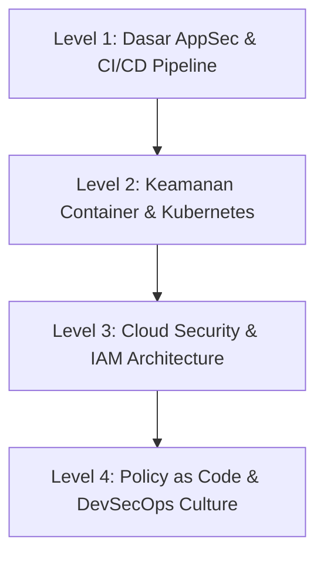

# ☁️ Domain: Keamanan Cloud & DevSecOps (AppSec & Infrastructure Security)

Jalur **Keamanan Cloud & DevSecOps** menggabungkan pengembangan perangkat lunak modern, otomatisasi CI/CD, dan infrastruktur cloud dengan prinsip keamanan yang disematkan sejak awal (*Shift-Left Security*).

---

## 🗺️ Tahapan Belajar (Level 1 - Level 4)

### 🔹 Level 1: Application Security (AppSec) & Integrasi Pipeline
- [ ] Memahami perbedaan SAST, DAST, SCA, dan Secret Scanning:
  - **SAST**: Memeriksa source code mentah sebelum dicompile (Semgrep, SonarQube).
  - **SCA**: Mendeteksi kerentanan pada dependensi pihak ketiga/open-source (Trivy, OWASP Dependency-Check).
  - **Secret Scanning**: Mencegah kebocoran API Key dan token di commit Git (Gitleaks, Trufflehog).
  - **DAST**: Menguji aplikasi saat sedang berjalan di staging (OWASP ZAP CLI).
- [ ] Mengintegrasikan security gate pada GitHub Actions / GitLab CI.

### 🔹 Level 2: Keamanan Kontainer & Orkestrasi (Docker & Kubernetes)
- [ ] **Docker Security**:
  - Menghindari penggunaan user `root` di dalam Dockerfile (`USER nonroot`).
  - Menggunakan *minimal base images* (Distroless / Alpine) untuk mengurangi *attack surface*.
  - Pemindaian celah image kontainer dengan Trivy.
- [ ] **Kubernetes Security (K8s)**:
  - Pembatasan Role-Based Access Control (RBAC).
  - Network Policies untuk isolasi pod antar-namespace.
  - Implementasi Admission Controllers (Kyverno / OPA Gatekeeper).

### 🔹 Level 3: Keamanan Cloud (AWS / GCP / Azure)
- [ ] Konsep *Shared Responsibility Model* di Cloud.
- [ ] Prinsip *Least Privilege* pada IAM (Identity & Access Management).
- [ ] Pencegahan salah konfigurasi cloud (*Misconfiguration*) dengan CSPM (Cloud Security Posture Management) seperti ScoutSuite atau Prowler.

### 🔹 Level 4: Policy as Code & DevSecOps Lanjutan
- [ ] Mengamankan *Infrastructure as Code* (IaC) Terraform/CloudFormation menggunakan Checkov atau tfsec.
- [ ] Manajemen vulnerability terpusat dengan DefectDojo.
