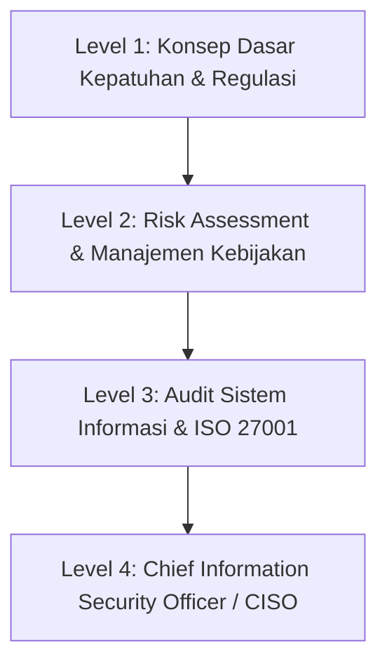

# 🏛️ Domain: Tata Kelola, Risiko, Kepatuhan (GRC) & Audit

Jalur **GRC (Governance, Risk, and Compliance)** dan **Audit Keamanan Informasi** berfokus pada penyelarasan strategi keamanan siber dengan tujuan bisnis, manajemen risiko operasional, kepatuhan terhadap regulasi hukum (seperti UU PDP), dan penilaian kontrol keamanan secara independen.

---

## 🗺️ Tahapan Belajar (Level 1 - Level 4)

### 🔹 Level 1: Pengenalan Regulasi & Dasar Kepatuhan
- [ ] Memahami terminologi hukum: Data Controller, Data Processor, Subjek Data Pribadi, Kerahasiaan Bank, Rahasia Medis.
- [ ] Mengetahui kerangka regulasi nasional: UU PDP (No. 27/2022), UU ITE, Peraturan BSSN, Surat Edaran OJK / Bank Indonesia terkait ketahanan siber.
- [ ] Memahami peran DPO (Data Protection Officer) / Pejabat Perlindungan Data Pribadi (PPDP).

### 🔹 Level 2: Penilaian Risiko (Risk Assessment) & Penyusunan Kebijakan
- [ ] Metodologi Penilaian Risiko (ISO 31000, NIST SP 800-30).
- [ ] Matriks Risiko: Menghitung *Likelihood x Impact = Risk Score*.
- [ ] Penyusunan Kebijakan Keamanan Informasi (*Information Security Policy*), SOP Penanganan Insiden, dan Kebijakan Akses Kontrol.
- [ ] Pelaksanaan *Data Protection Impact Assessment (DPIA)*.

### 🔹 Level 3: Audit Sistem Informasi & Standardisasi Internasional
- [ ] Implementasi dan audit **ISO/IEC 27001:2022** (Information Security Management System - ISMS):
  - Memahami 4 tema kontrol Annex A: *Organizational Controls, People Controls, Physical Controls, Technological Controls*.
- [ ] Pelaksanaan Audit Internal Sistem Informasi (teknik sampling, wawancara, pemeriksaan bukti kontrol/audit trail).
- [ ] Standar audit global: SOC 2 (Type 1 & Type 2), PCI-DSS (Industri Pembayaran Kartu).

### 🔹 Level 4: Strategi Eksekutif & CISO (Chief Information Security Officer)
- [ ] Mengomunikasikan risiko teknis siber kepada Dewan Direksi (*Board of Directors*) dalam bahasa finansial dan risiko reputasi.
- [ ] Manajemen Krisis dan Keberlangsungan Bisnis (*Business Continuity Plan / BCP & Disaster Recovery Plan / DRP*).
- [ ] Alokasi anggaran keamanan siber berbasis analisis ROI dan mitigasi risiko.
