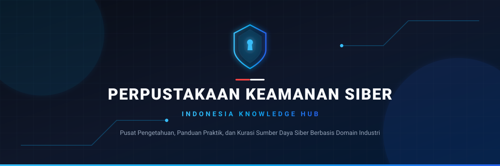

  

[🌐 Buka Versi Website](https://wahyusutejo1986.github.io/perpustakaan-keamanan-siber/) • [Jelajahi Domain](#-direktori-domain-keamanan-siber) • [Panduan Orientasi](00-panduan-dan-orientasi/cara-menggunakan-repo.md) • [Glosarium Istilah](00-panduan-dan-orientasi/glosarium-istilah-siber.md) • [Kontribusi](CONTRIBUTING.md) • [Penafian Hukum](DISCLAIMER.md)

---

## 🎯 Visi & Misi Repositori

Dunia keamanan siber terus berkembang dengan pesat. Repositori ini mengadopsi standar taksonomi industri (mengacu pada prinsip kerja **NIST NICE Framework** dan **SKKNI Bidang Keamanan Siber di Indonesia**) dengan membagi materi ke dalam **Domain Keahlian Terpadu**.

Setiap domain merupakan **"Pojok Belajar Mandiri"** yang langsung memadukan:
- 🗺️ **Roadmap**: Alur belajar terarah dari Level 1 (Dasar) hingga Level 4 (Mahir).
- 🛠️ **Katalog Tools**: Alat bantu *open-source* pilihan yang relevan dengan domain tersebut.
- 📐 **Standar & Metodologi**: Panduan industri resmi (NIST, MITRE ATT&CK, OWASP, ISO 27001).
- 🧪 **Laboratorium & Praktik**: Tempat latihan aman, aplikasi rentan (*vulnerable apps*), dan konfigurasi pengerasan sistem (*hardening*).

---

## 🧭 Baru Memulai? Ikuti Jalur Ini!

Jika Anda baru pertama kali terjun ke dunia keamanan siber, ikuti alur bertahap berikut:
1. **Pahami Cara Menggunakan Repo**: Baca [00. Panduan & Orientasi](00-panduan-dan-orientasi/cara-menggunakan-repo.md).
2. **Kuasai Literasi & Payung Hukum**:
   - [Panduan Cyber Hygiene Masyarakat](01-fondasi-teknis-dan-literasi/cyber-hygiene-masyarakat.md)
   - [Etika & Regulasi Siber Indonesia (UU PDP & UU ITE)](00-panduan-dan-orientasi/etika-dan-hukum-id.md)
3. **Bangun Fondasi Teknis**:
   - [Dasar Jaringan Komputer](01-fondasi-teknis-dan-literasi/dasar-jaringan-komputer.md)
   - [Dasar Sistem Operasi Linux & Windows](01-fondasi-teknis-dan-literasi/dasar-sistem-operasi.md)
   - [Pemrograman untuk Otomasi Siber](01-fondasi-teknis-dan-literasi/pemrograman-untuk-siber.md)
4. **Pilih Spesialisasi Domain** sesuai minat karier Anda pada tabel di bawah.

---

## 📂 Direktori Domain Keamanan Siber

| Domain | Bidang Keahlian | Deskripsi Singkat | Tautan Modul |
| :---: | :--- | :--- | :---: |
| **00** | **Panduan & Orientasi** | Panduan navigasi, kamus istilah (*glosarium*), dan etika riset siber bertanggung jawab di Indonesia. | [Buka Modul](00-panduan-dan-orientasi/cara-menggunakan-repo.md) |
| **01** | **Fondasi Teknis & Literasi** | Cyber hygiene masyarakat umum, dasar jaringan (OSI & TCP/IP), sistem operasi, dan scripting Python/Bash. | [Buka Modul](01-fondasi-teknis-dan-literasi/cyber-hygiene-masyarakat.md) |
| **02** | **Offensive Security** | Red Team, Penetration Testing, Bug Bounty, OWASP WSTG, Active Directory attack, dan C2 frameworks. | [Buka Modul](02-offensive-security/roadmap-offensive.md) |
| **03** | **Defensive Security** | Blue Team, Security Operations Center (SOC), SIEM (Wazuh/Elastic), MITRE ATT&CK, Sigma Rules, YARA. | [Buka Modul](03-defensive-security/roadmap-defensive.md) |
| **04** | **Forensik Digital & Insiden (DFIR)** | Penanganan insiden (NIST SP 800-61), analisis bukti memori RAM (Volatility), disk forensik, dan malware reverse engineering. | [Buka Modul](04-forensik-digital-dan-insiden/roadmap-dfir.md) |
| **05** | **Cloud & DevSecOps** | Keamanan aplikasi (SAST/DAST/SCA), pengerasan Docker & Kubernetes, CI/CD security pipeline, dan cloud security (AWS/GCP/Azure). | [Buka Modul](05-keamanan-cloud-dan-devsecops/roadmap-cloud-dan-devsecops.md) |
| **06** | **Tata Kelola GRC & Audit** | Governance, Risk, & Compliance, audit sistem informasi, implementasi ISO/IEC 27001:2022, dan kepatuhan UU PDP No. 27/2022. | [Buka Modul](06-tata-kelola-grc-dan-audit/roadmap-grc-dan-auditor.md) |
| **07** | **Ekosistem Karier & Komunitas** | Matriks sertifikasi global vs SKKNI BNSP, direktori komunitas siber di Indonesia, dan tips portofolio / wawancara kerja. | [Buka Modul](07-ekosistem-karier-dan-komunitas/peta-sertifikasi-global-skkni.md) |
| **08** | **Cheatsheets & Playbooks** | Contekan perintah cepat Linux, Nmap network scanning, dan playbook tanggap darurat saat ransomware atau defacement. | [Buka Modul](08-cheatsheets-dan-playbooks/incident-response-playbook.md) |

---

## 🤝 Mari Berkontribusi!

Repositori ini adalah proyek terbuka milik bersama untuk memajukan ekosistem keamanan siber Indonesia. Anda dapat berkontribusi dengan cara:
- 💡 Mengusulkan tools atau referensi baru via [GitHub Issue Template](https://github.com/wahyusutejo1986/perpustakaan-keamanan-siber/issues/new/choose).
- 🔗 Melaporkan tautan mati (*broken link*).
- ✍️ Mengirimkan **Pull Request (PR)** materi baru sesuai panduan di [CONTRIBUTING.md](CONTRIBUTING.md).

---

## ⚖️ Penafian Hukum & Etika (Disclaimer)

Seluruh materi, dokumentasi, dan perangkat lunak yang dirujuk dalam repositori ini ditujukan semata-mata untuk **tujuan edukasi, riset etis, dan penguatan pertahanan sistem informasi**. 

Pengujian tanpa izin eksplisit dan sah dari pemilik sistem adalah tindakan ilegal di bawah ketentuan hukum Republik Indonesia (**UU ITE & UU PDP**). Pengelola dan kontributor tidak bertanggung jawab atas segala bentuk penyalahgunaan materi.

Silakan baca selengkapnya di [DISCLAIMER.md](DISCLAIMER.md).

---

  Dikelola dan dikurasi secara terbuka untuk kemajuan literasi dan talenta keamanan siber Indonesia 🇮🇩

